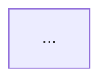

# Explain Bug

> Evidence sources: blameless postmortem practice (a summary, a timeline, the proximate cause then contributing factors then latent conditions, impact, and what is unknown; "human error" is a symptom, not a cause), [Zeller, Scientific Debugging](https://www.st.cs.uni-saarland.de/whyprogramsfail/pdf/ScientificMethod.pdf) (an explanation must match the observations), [ASD-STE100](https://www.asd-ste100.org/) and the Brazilian Linguagem Simples rules (Rede Nacional de Linguagem Simples, Decreto 9.191/2017) used by `grammar-review` and `understand-the-intent` in this plugin, the Mermaid [sequence diagram](https://mermaid.js.org/syntax/sequenceDiagram.html) and [flowchart](https://mermaid.js.org/syntax/flowchart.html) syntax, and `design-doc-mermaid` in this plugin. Structure follows `implementation-planning` (AS IS diagrams from evidence).

Make the user understand the bug in one read, in either language, and see the step where it breaks.

This skill writes text and diagrams. It changes no code and proposes no fix. Fix options are in `propose-solutions`.

## Why this process

1. **A diagram shows what a paragraph hides.** Drawing the flow forces you to name each step and the step that fails. If a step cannot be drawn, the cause is not understood.
2. **Two languages, one meaning.** The user's team reads English and Portuguese. Each version is written in its own plain-language style. The Portuguese is not a word-for-word translation of the English.
3. **Facts only.** Each statement traces to the symptom card, the reproduction, or an experiment. An invented step in a diagram is worse than a missing one.
4. **State the confidence.** The reader decides on the fix from the label (Confirmed, Likely, Unconfirmed, Unreproduced) and the list of what is not verified.
5. **Short wins.** One page per language. Details live in `diagnosis.md`.

## When to use

- Step 5 of `diagnose-and-reproduce`.
- The user has a diagnosis and wants it explained or drawn, for themselves or for a team.

## When NOT to use

- There is no reproduction and no root cause. Explain what is known only if the user asks, and label it **Unconfirmed**.
- The user wants fix options. Use `propose-solutions`.
- The user wants only a correction of their own text. Use `grammar-review`.

## Process

### Step 0: Read, and gather facts

0. If `docs/<slug>/diagnosis.md` does not exist (this skill was called alone), pick a slug, ask the user for the missing facts in one `AskUserQuestion` call, and create the file from [the template](../diagnose-and-reproduce/references/diagnosis-template.md).
1. Read `docs/<slug>/diagnosis.md` fully: symptom card, hypotheses, reproduction, root cause, experiment log.
2. Read the code of the failing flow, only to name the real components, functions, and calls for the diagrams. Use real names from the code. Do not invent a function, a service, or a message.
3. List the **facts** you will use. For each, note its source (a log line, a trace ID, a test output, an experiment). A claim with no source does not go in. It goes under "Not verified".
4. Choose a **glossary**: 5 to 10 terms for the key things (the service, the entity, the state, the error). Use one term for one thing in both languages, in the text and in the diagrams.

### Step 1: Write the English version

Read [references/language.md](references/language.md). Write in ASD-STE100 Simplified Technical English. Use this structure, with these headings:

1. **Summary.** Two or three sentences: what breaks, why, and how sure we are.
2. **What the user sees.** The symptom, with the expected and the actual behavior.
3. **Root cause.**
   - **Direct cause:** the code, data, or condition that makes the symptom.
   - **Contributing factors:** what made it likely or hid it.
   - **Underlying conditions:** what stays true after a fix and allows the same class of bug.
4. **How we know.** The reproduction command, the key lines of its output (redacted), and the experiment that supports the cause.
5. **Confidence.** Confirmed, Likely, Unconfirmed, or Unreproduced, with one line on why. If not Confirmed, what is missing.
6. **Not verified.** What we did not check, and what could change the picture.
7. **Impact and scope.** Who and what is affected, how often, since when (from the symptom card). Only what the evidence shows.

### Step 2: Draw the diagrams

Read [references/diagrams.md](references/diagrams.md). Draw these:

1. **Sequence diagram of the failing flow.** Participants are real components. Show each call and return in order. Mark the faulty step with a `Note over` or a highlighted `rect`. Show the wrong value where it first appears. This is required.
2. **Flowchart of the decision or data path.** Show the branch or the condition where the flow goes wrong, and the path that works. Color the failing branch. This is required when the bug depends on a condition or on data. If the sequence diagram already shows everything, say so and skip the flowchart.
3. **Timeline or state diagram** only for races, ordering, retries, expiry, or a state machine. Show two actors and the overlap that causes the bug.

Diagram rules:

- Labels in English, short, using the glossary terms. A Portuguese caption goes under each diagram (see Step 3).
- Show only what the evidence shows. Mark anything inferred with `(inferred)`.
- No secrets, tokens, or personal data in a label.
- Check the syntax. If `mmdc` (mermaid-cli) is installed, render each diagram to a temporary file to validate. Otherwise read it carefully. See `design-doc-mermaid` for the helper scripts.

### Step 3: Write the Portuguese version

Write in Brazilian Portuguese, in Linguagem Simples. Do not translate sentence by sentence. Say the same facts, with the same glossary terms, in natural plain Portuguese. Use the same headings, translated:

1. **Resumo.**
2. **O que a pessoa usuária vê.**
3. **Causa raiz.** Causa direta, fatores que contribuem, condições de fundo.
4. **Como sabemos.**
5. **Confiança.** Confirmada, Provável, Não confirmada, Não reproduzida.
6. **Não verificado.**
7. **Impacto e alcance.**

Put one short Portuguese caption under each diagram, saying what the reader should notice ("Legenda: o valor fica nulo no passo 4, antes da chamada ao serviço de pagamento."). The diagram labels stay in English, so one diagram serves both.

Keep code, paths, commands, error strings, and glossary terms for code identifiers exactly as they are in the code.

### Step 4: Check the two versions

- Same facts in both. The same number of root-cause items. The same confidence label.
- Same glossary terms in the text, the diagrams, and the captions.
- Sentences are short (about 20 words or fewer), in the active voice, one idea each.
- No fact without a source. No fix.
- Each diagram matches the text and the experiment log.

### Step 5: Write and show

1. Write section 5 of `docs/<slug>/diagnosis.md`: the English version with its diagrams, then the Portuguese version with the captions.
2. Show the explanation in the chat: both versions, the diagrams in Mermaid code blocks.
3. Ask for corrections only if the user sees a wrong fact. Do not hold up the next step.

## Output

````markdown
## 5. Explanation

### English

**Summary** ...
**What the user sees** ...
**Root cause** ...
**How we know** ...
**Confidence** ...
**Not verified** ...
**Impact and scope** ...

```mermaid
sequenceDiagram
  ...
```
Caption (PT): ...


Caption (PT): ...

### Português

**Resumo** ...
...
````

## Common rationalizations

| Rationalization | Reality |
|---|---|
| "The diagram is a rough idea." | A wrong diagram teaches the wrong cause. Draw only what the evidence shows, and mark the rest `(inferred)`. |
| "I will translate the English." | A literal translation reads stiff and breaks plain-language rules. Write each version in its own style. |
| "The cause is a race." | Show which two actors overlap, in a timeline. "A race" alone is not an explanation. |
| "The cause is human error." | Write the condition that made the error easy and the check that missed it. |
| "I will add what probably happened." | Put it under "Not verified", or leave it out. |
| "A long explanation is more complete." | One page per language. Put detail in `diagnosis.md`. |
| "The label does not matter much." | The reader picks the fix from it. State it, and what is missing. |

## Red flags

- A step, a function, or a message in a diagram that no evidence supports and no `(inferred)` mark.
- The English and the Portuguese differ in facts, counts, or the confidence label.
- The Portuguese is a word-for-word translation.
- A different term for the same thing in the text and the diagram.
- Raw logs, tokens, or personal data in the text or a diagram.
- A fix, a workaround, or a recommendation in the explanation.
- "Human error", "a bug", or "a race" given as the cause with no mechanism.
- The confidence label is missing, or higher than the evidence supports.
- A Mermaid block that does not render.

## Verification

- [ ] Every statement traces to the diagnosis file.
- [ ] The English version follows ASD-STE100 and the Portuguese follows Linguagem Simples, with the same facts and the same label.
- [ ] A sequence diagram shows the failing flow and marks the faulty step. A flowchart shows the condition, or the report says why it is skipped.
- [ ] Diagram labels use the glossary. Each diagram has a Portuguese caption.
- [ ] Inferred steps are marked. Nothing sensitive is in a label.
- [ ] Mermaid syntax was validated or read carefully.
- [ ] The confidence label and the "Not verified" list are present in both languages.
- [ ] No fix or recommendation appears.
- [ ] Section 5 of `diagnosis.md` is written, and the explanation was shown in the chat.
