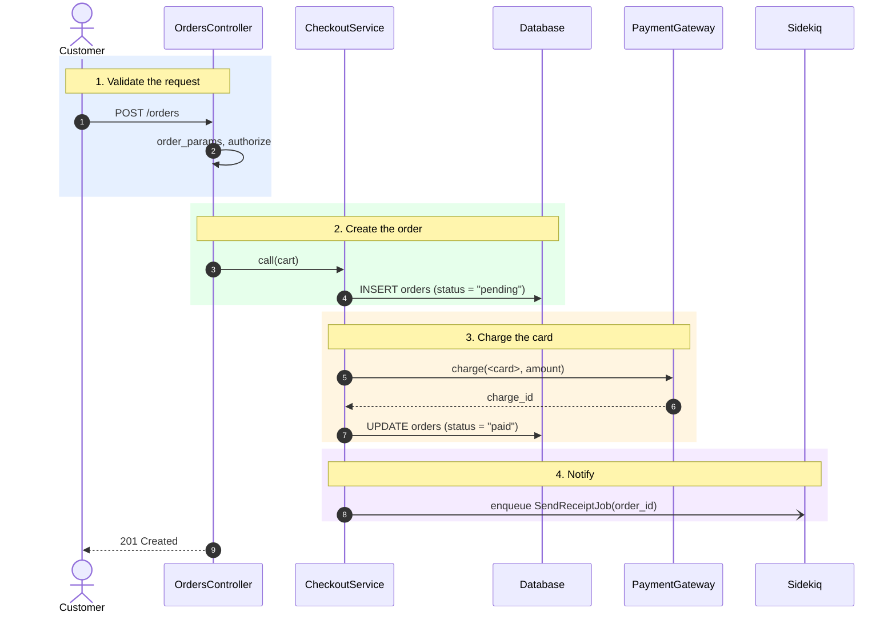
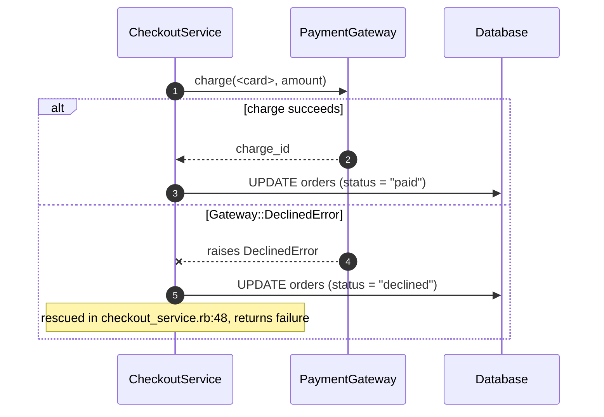
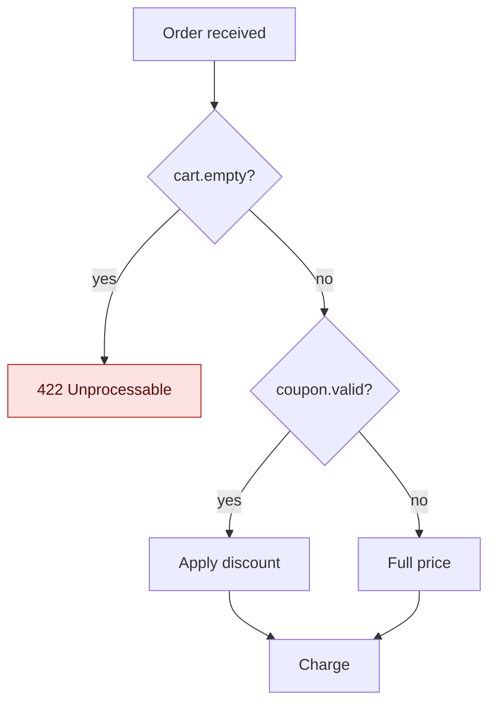
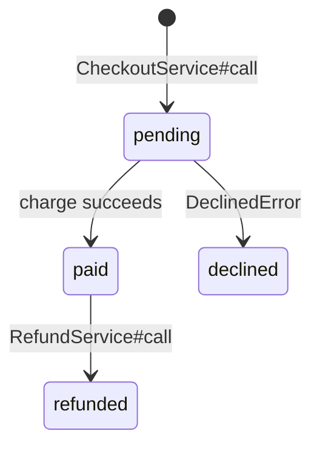

# Diagrams for a flow

Use in Step 6 of `explore-flow`. Mermaid is the format. For more patterns read `design-doc-mermaid` in this plugin (`references/guides/diagrams/sequence-diagrams.md`, `activity-diagrams.md`, and `references/guides/troubleshooting.md`). The bug-specific version of these rules is in `explain-bug/references/diagrams.md`.

Sources: [Mermaid sequence diagram](https://mermaid.js.org/syntax/sequenceDiagram.html), [Mermaid flowchart](https://mermaid.js.org/syntax/flowchart.html), [Mermaid state diagram](https://mermaid.js.org/syntax/stateDiagram.html), [Mermaid CLI](https://github.com/mermaid-js/mermaid-cli).

## Rules

1. **Evidence only.** Each arrow is a hop in the trace table. Mark an inferred step with `(inferred)` in its label.
2. **Real names.** Participants are real components, with the class or package in the alias: `participant S as PaymentService`.
3. **Order participants by layer**, left to right: caller, entry point, services, data store, external systems, queues and workers.
4. **One idea per diagram.** About 10 participants and 25 messages at most. Split a bigger one by part.
5. **Short labels** in the doc's language for actions, code names for calls: `charge(order)`, `INSERT orders`, `enqueue SendReceiptJob`.
6. **Concrete values** where they explain a branch: `status = "pending"`, `amount > 0`.
7. **No sensitive data.** Use `<user-id>`, `<token>`, `<card>` placeholders.
8. **A caption** under each diagram, one line in the doc's language: what to notice.

## 1. Overview sequence diagram

The whole flow, each part in a numbered `rect`. Use a light fill so text stays readable in light and dark themes.

Caption: the charge runs after the order row is saved, so a failed charge leaves a `pending` order.

## 2. Sequence diagram per part

Show the branches with `alt` and the real condition. Show the error path.

Arrows:

- `->>` a call, `-->>` a return, `--x` a failure, `-)` an async message (enqueue, publish).
- `activate` / `deactivate` (or `+` / `-`) only when the lifetime matters.
- `par` for concurrent work. `loop` for batches and retries, with the limit from the code: `loop up to 3 retries`.
- `Note over` for a transaction: `Note over S,D: inside ActiveRecord transaction`.

## 3. Flowchart for a decision-heavy part

Only when several conditions decide the result. Label each decision with the real condition.

## 4. State diagram for status changes

Only when the flow moves a record through statuses. Each transition cites the method that makes it in the text.

## 5. Checks before you ship a diagram

Validate with `python3 <design-doc-mermaid skill dir>/scripts/extract_mermaid.py <doc> --validate` when `mmdc` is installed. Otherwise check by hand:

- Each participant or node is declared once and spelled the same everywhere.
- A label with `(`, `)`, `:`, `;`, `#`, `{`, `}`, or quotes in a flowchart node is wrapped in double quotes.
- Each `rect`, `alt`, `opt`, `loop`, `par`, and `critical` block has its `end`.
- No node or participant is named `end`.
- `classDef` styles set `color:` so text stays readable.
- Each arrow is in the trace table. Inferred steps are marked.
