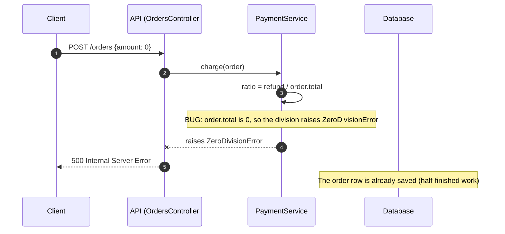
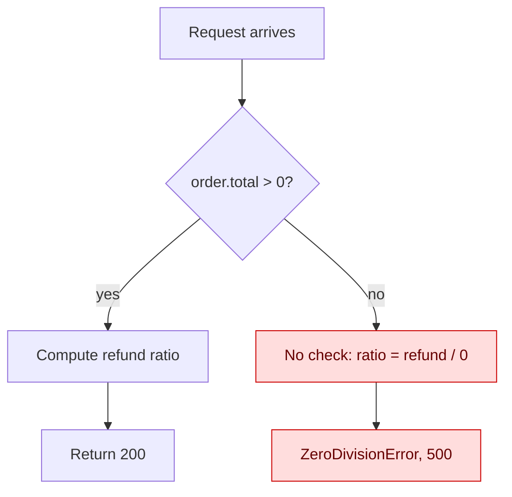
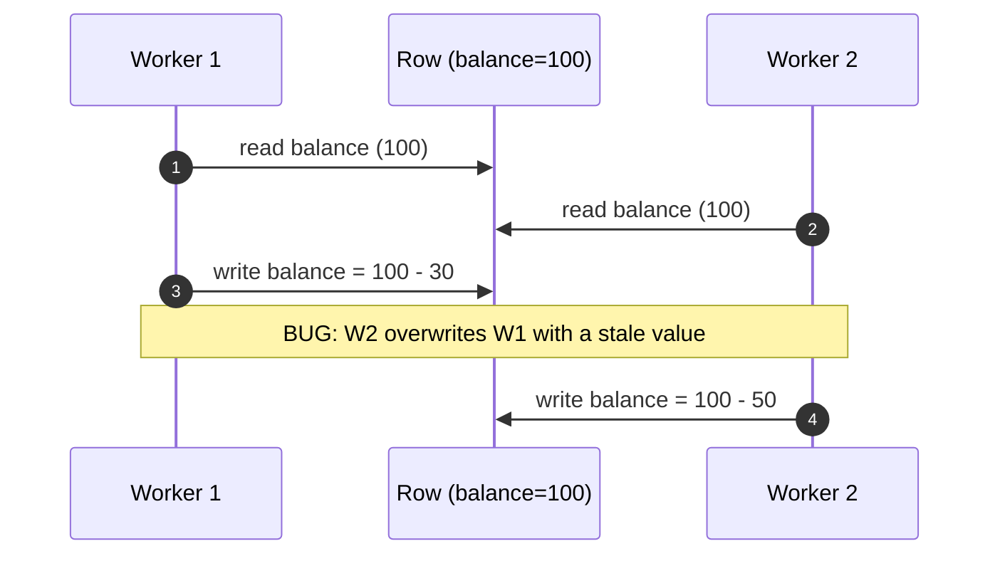
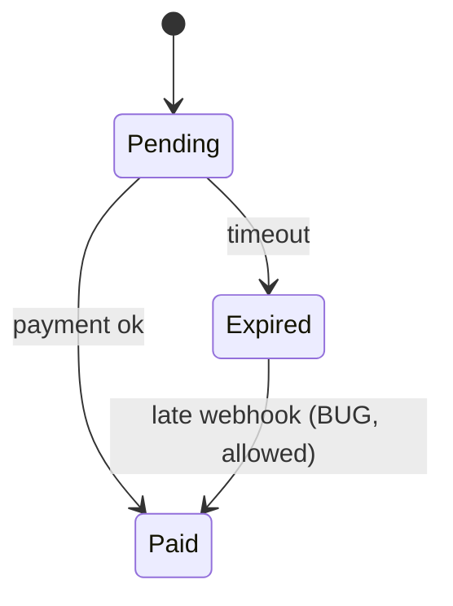

# Diagrams for a bug explanation

Use in Step 2 of `explain-vulnerability` and in `propose-vulnerability-fixes` (the AS IS and TO BE diagrams). Mermaid is the format. The `design-doc-mermaid` skill in this plugin has fuller guides (`references/guides/diagrams/sequence-diagrams.md`, `activity-diagrams.md`) and a validation script.

Sources: [Mermaid sequence diagram](https://mermaid.js.org/syntax/sequenceDiagram.html), [Mermaid flowchart](https://mermaid.js.org/syntax/flowchart.html), [Mermaid state diagram](https://mermaid.js.org/syntax/stateDiagram.html), [Mermaid CLI](https://github.com/mermaid-js/mermaid-cli), and `design-doc-mermaid` in this plugin.

## Rules

1. **Evidence only.** Draw the calls you saw in the code, the trace, or the experiment. Mark an inferred step with `(inferred)` in its label.
2. **Real names.** Use the names of the real components and functions.
3. **Mark the break.** The reader must see the faulty step in two seconds. Use a `Note`, a color, or a `rect`.
4. **Show the wrong value where it first appears.**
5. **One idea per diagram.** If it needs more than about 12 elements, split it.
6. **English labels, short.** Use the glossary terms. A Portuguese caption goes under the diagram.
7. **No sensitive data.** Use `<user-id>`, `<token>`, `<amount>` placeholders.
8. **Valid syntax.** Quote labels that contain parentheses, colons, or slashes. Avoid `end` as a word in a flowchart label. If `mmdc` is installed, render each diagram once to check it.

## 1. Sequence diagram of the failing flow

Use for any bug that crosses components or time.

Tips:

- `->>` is a call, `-->>` a return, `--x` a failed message.
- `rect rgb(255, 235, 235)` ... `end` highlights a block. Use sparingly.
- `alt` / `else` shows the branch that differs between the passing and the failing case.
- `par` shows concurrent work for a race. A timeline is often clearer (see below).

## 2. Flowchart of the decision or data path

Use when a condition, a branch, or a data transformation decides the result.

Tips:

- Put the failing branch in a `bad` class. Keep the working path in the default style.
- Label the decisions with the real condition from the code.
- A diagram of AS IS (the flow that fails) and TO BE (the flow after the fix) is made in `propose-vulnerability-fixes`, one TO BE per option.

## 3. Timeline for races and ordering

Use a sequence diagram with two actors and a shared resource, and number the steps so the interleaving is visible:

State changes (expiry, retries, a state machine) read well as a state diagram:

## 4. Captions

Under each diagram, write one line in English and one in Portuguese ("Legenda") that says what to notice. The Portuguese caption names the same step and the same value.

## 5. Checks before you ship a diagram

- Each arrow is in the code, the trace, or an experiment.
- The faulty step is marked.
- Terms match the glossary.
- No secret or personal data.
- It renders.

## Vulnerability diagrams

- **Attacker as a participant.** Name the actors by role: `Attacker (user A)`, `Victim (user B)`, `API`, `Policy check`, `Database`. Use the roles of the finding card, never real accounts.
- **Mark the missing or broken control.** In the sequence diagram, put a `Note over` on the step where the check is absent, wrong, or bypassed. Show what the attacker gets back.
- **Trust boundary in the flowchart.** Draw the line where untrusted input enters and the node where it reaches the sink. Color the path that skips the control. Add the path of a legitimate request next to it.
- **Blocked case.** When the attack is stopped, draw the same flow and end it at the control that rejects it. Name the file and line in the node label. Show where the proof test asserts the rejection.
- **No payloads.** A label says "crafted id of another user", not the string. No working exploit in a diagram.
