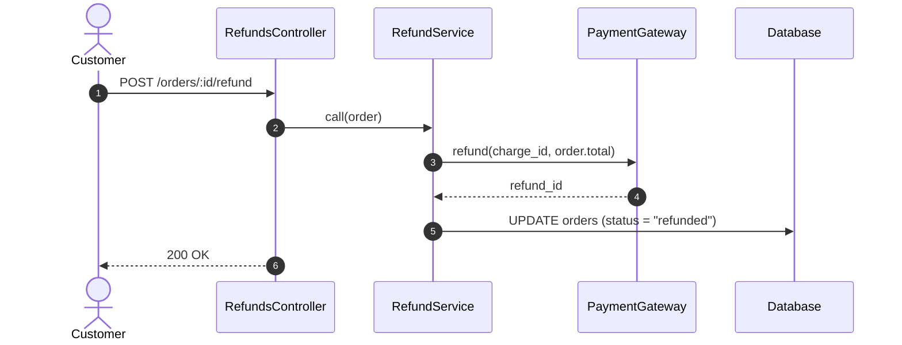
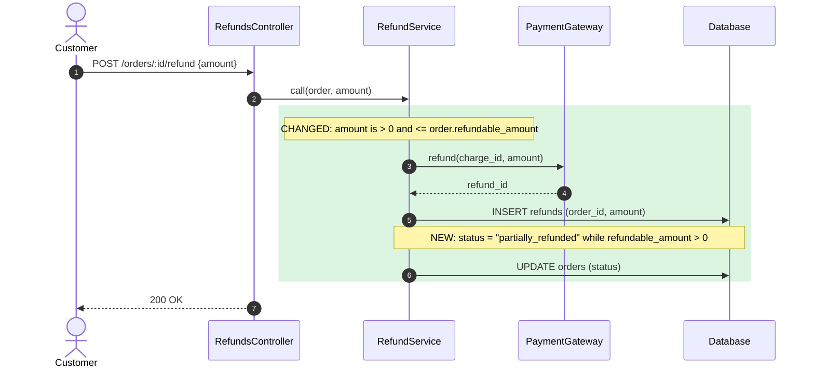
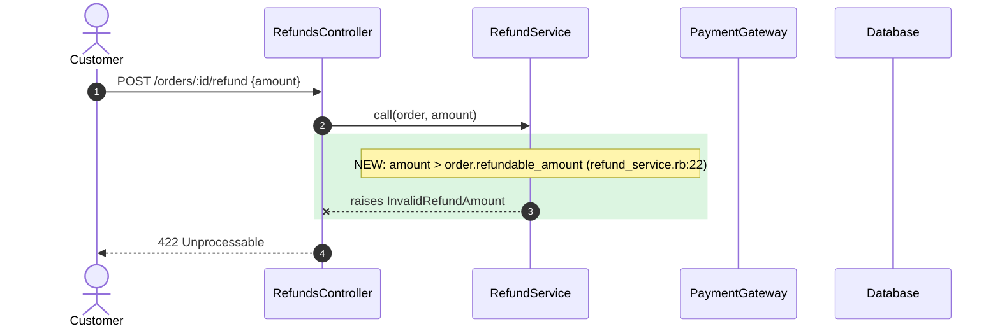
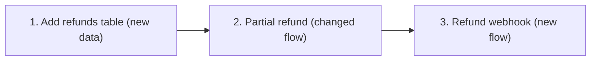

# AS IS and TO BE diagrams

Use in Step 6 of `flow-diff`. The base rules (evidence only, real names, layer order, size limits, captions, no sensitive data, hand checks) are in [the flow-as-is diagram rules](../../flow-as-is/references/diagrams.md). This file adds the rules for comparing two versions of one flow.

## Rules for a pair

1. **Same frame.** The AS IS and the TO BE of one scenario start at the same entry point and end at the same boundary. Declare the same participants in the same order. Declare a participant that exists only in one version in both diagrams, in the same position, so the columns line up.
2. **Same words.** Use the same glossary term for the same thing in both diagrams and both captions.
3. **AS IS from the base.** Each arrow is a hop on the merge base. The caption says `Base: <base-sha>`.
4. **Mark the change in TO BE.**
   - Added or changed steps: inside `rect rgb(220, 245, 225)` with a `Note` that starts with `NEW:` or `CHANGED:`.
   - Removed steps: a `Note` that starts with `REMOVED:` at the place where the step was.
   - Unchanged steps: no mark.
5. **Context, not the whole world.** Show the entry point, the hop before and after each change, and the changed hops. Collapse long unchanged stretches into one self-call with a short label (`C->>C: validate params (unchanged)`).
6. **A caption for each.** AS IS: what the flow did. TO BE: what is different and what to notice.
7. **One pair per scenario, no `alt`.** Never use `alt`, `opt`, or `else`. Each branch and error path of a changed flow is its own scenario, titled with a short description of what happens (no letters or numbers), as in [the flow-as-is diagram rules](../../flow-as-is/references/diagrams.md#2-sequence-diagrams-per-part-one-per-scenario). Draw an AS IS and a TO BE for each scenario that exists on both sides. A scenario that exists only in the TO BE gets a TO BE diagram only, marked `NEW:`. A scenario that exists only on the base gets an AS IS diagram only, marked `REMOVED:` in the caption. A scenario that did not change gets no diagram. When a scenario has stages of its own, split it into one diagram per stage, each titled with what the stage does, on both sides.

## Example: a changed flow

The refund flow has two scenarios in the TO BE: "The refund goes through" (it exists on the base, and it changed), and "The amount is not valid" (new).

"The refund goes through", AS IS (base `a1b2c3d`):

Caption: the service always refunds the full order total.

"The refund goes through", TO BE:

Caption: the request now takes an amount; the service records each refund in `refunds` and sets a partial status.

"The amount is not valid", TO BE only (new scenario, no AS IS):

Caption: a new scenario. An amount over the refundable amount stops before the gateway call and returns `422`. On the base there was no amount to check.

## New and removed flows

- **New flow:** one TO BE diagram. No marks, since every step is new. The caption says "New flow".
- **Removed flow:** one AS IS diagram from the base. The caption says what replaces it, or "No replacement".

## Change map (optional)

When there are 3 or more units, one small flowchart in the general context. One node per unit, arrows only for real dependencies, the class of each unit in the label.

